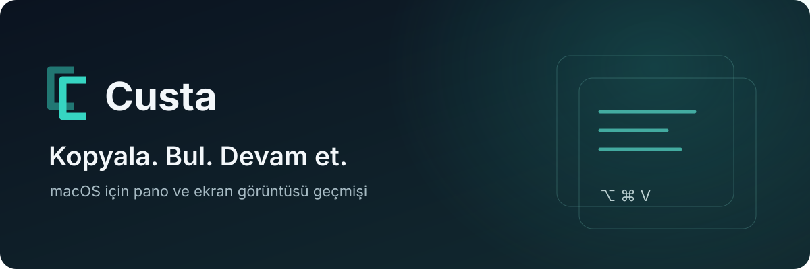

  
    
  
  
<strong>v0.12.6</strong> · macOS 14 ve üzeri · Apple Silicon &amp; Intel · Universal ZIP

  
<a href="docs/KULLANIM.md">Kullanım rehberi</a> · <a href="https://github.com/aliyasirusta/custa-releases/releases/tag/v0.12.6">Sürüm notları</a> · <a href="https://github.com/aliyasirusta/custa-releases/issues">Sorun bildir</a>

---

Kopyaladığın bir metni, bağlantıyı veya ekran görüntüsünü yeniden bulmak için işini bölme. **Custa**, geçmişini menü çubuğunda toplar. **⌥⌘V** ile aç, ara ve tek tıkla kopyala.

### Her gün elinin altında

| | Custa ile |
|---|---|
| **Pano geçmişi** | Metinleri, bağlantıları ve görselleri ara; sık kullandıklarını sabitle. |
| **Ekran görüntüleri** | Klasör seçmeden macOS ekran görüntülerini algıla, OCR ile içindeki yazıyı ara. |
| **Görsel düzenleme** | Ok, çizgi, şekil ve not ekle; kırp, hassas alanları opak kapat, PNG olarak kaydet. |
| **Metin araçları** | Base64 dönüştür/çöz; iki metni yan yana karşılaştır. |
| **Şifre araçları** | Şifre üret, açıklamayla kaydet; macOS Anahtar Zinciri’nde sakla. |
| **Sana göre görünüm** | Saydam veya koyu tema; taşınabilir pencere ve her zaman üstte tutma. |

### Üç adımda başla

1. Yukarıdaki **Mac için Custa’yı indir** düğmesine bas. Releases sayfasına uğramadan ZIP dosyasını indirir.
2. ZIP’i aç. **Custa.app’i Uygulamalar’a elle taşı** ve oradan aç. Otomatik kurulum veya taşıma yapılmaz.
3. Menü çubuğundaki Custa simgesine tıkla ya da **⌥⌘V** kullan. Listeden seç, kopyala, hedef uygulamada **⌘V** ile yapıştır.

> **İlk açılışta macOS uyarısı çıkabilir.** Custa henüz Apple Developer ID imzası ve noter onayı taşımıyor. Bu resmi repodan indirdiğine güveniyorsan, açmayı denedikten sonra **Sistem Ayarları → Gizlilik ve Güvenlik → Yine de Aç** yolunu kullan. [Kurulum ayrıntıları](docs/KULLANIM.md#kurulum)

### Klavyeden hızlıca

| Aç / kapat | Ara | İlk dokuz kaydı kopyala | Önizle |
|:---:|:---:|:---:|:---:|
| **⌥⌘V** | **⌘F** | **⌘1–9** | **Space** |

Kısayollar ayarlardan özelleştirilebilir. [Tüm kısayollar ve kullanım](docs/KULLANIM.md#varsayılan-kısayollar)

### Yerel çalışır, kontrol sende kalır

Hesap, telemetri ve bulut senkronizasyonu yoktur. OCR, Base64 ve metin karşılaştırma cihazında çalışır. Şifreler **macOS Anahtar Zinciri’nde**; pano geçmişi, görseller ve taslaklar **yerelde, şifrelenmeden** tutulur. Güncelleme denetimi GitHub’a bağlanır; pano içeriğin gönderilmez.

[Erişim izinleri ve gizlilik](docs/KULLANIM.md#izinler-ve-gizlilik) · [Veri konumu, silme ve kaldırma](docs/KULLANIM.md#veriler-nerede-nasıl-silinir)

### Sık sorulanlar

**Her güncellemede ZIP indirmem gerekiyor mu?**
Hayır. Uygulamalar’dan çalışan Custa’da **Ayarlar → Güncellemeleri denetle…** yolunu kullan. İmzalı güncellemeler onayınla yüklenir.

**İndirilenler’den açabilir miyim?**
Evet. Uygulama içi güncellemeler için Custa’dan çık, Uygulamalar’a elle taşı ve oradan yeniden aç.

**Bütün ekran görüntülerim gelir mi?**
Algılama dosya erişimine, macOS ekran görüntüsü işaretlerine ve Spotlight kapsamına bağlıdır. Bazı konumlar ve üçüncü taraf yakalamalar eksik kalabilir. [Sınırlar](docs/KULLANIM.md#araçlar-ve-bilinen-sınırlar)

**Bir sorun buldum, nereye yazmalıyım?**
[Issues](https://github.com/aliyasirusta/custa-releases/issues) üzerinden Custa/macOS sürümünü, tekrarlama adımlarını ve beklediğin sonucu paylaş. Ekran görüntülerindeki şifreleri ve kişisel bilgileri gizle.

---

Custa is a native macOS clipboard and screenshot history app with on-device OCR, image annotation, text tools and password generation. This repository hosts official downloads, documentation and the signed update feed. Application source is private. Free download does not grant a source-code license.
